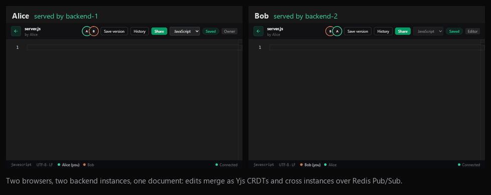
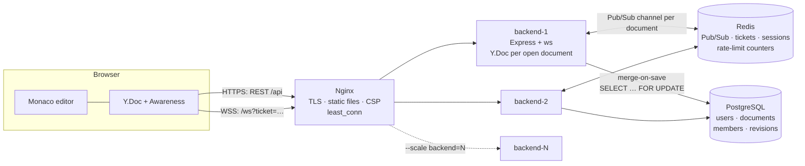
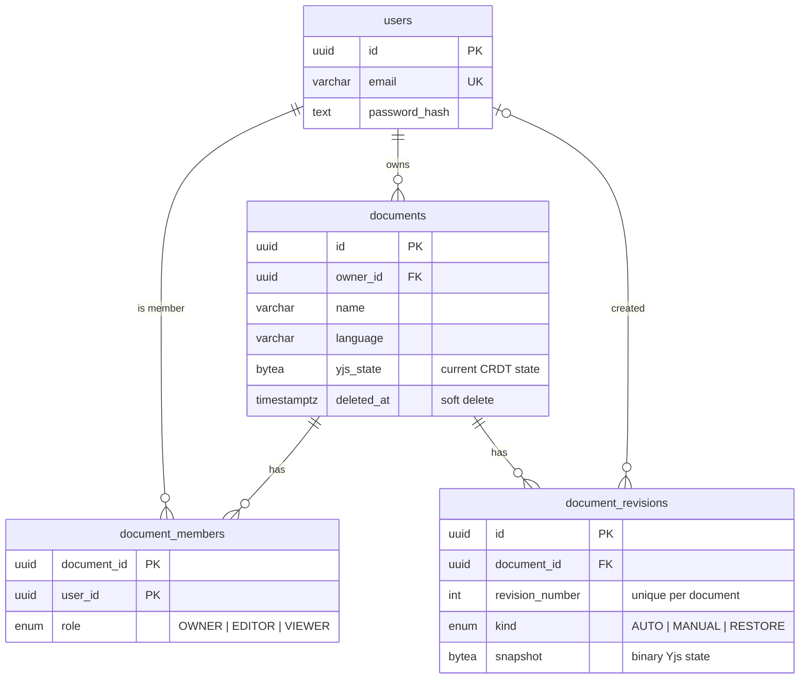
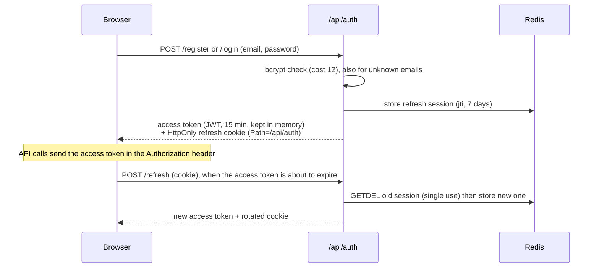
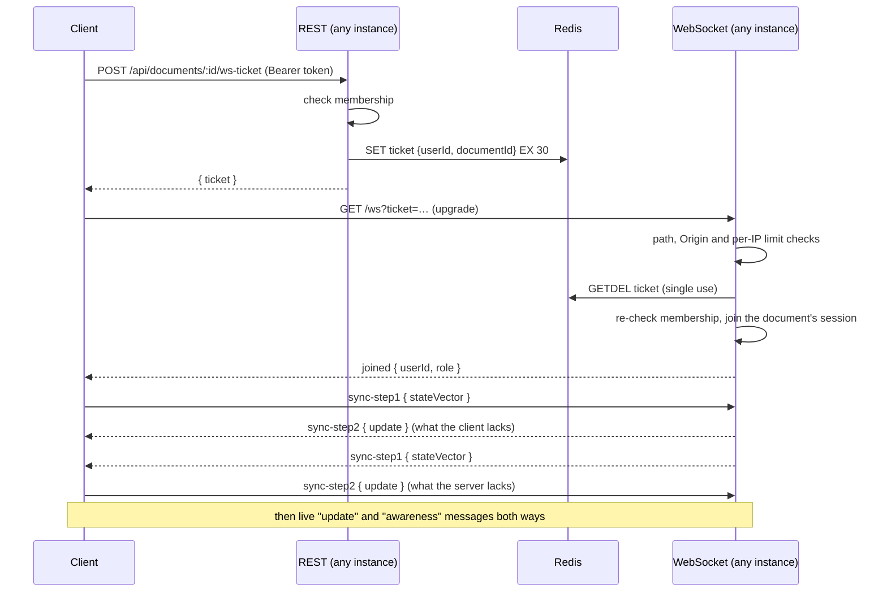

# Real-Time Collaborative Code Editor

Several people edit the same file at the same time, in a VS Code-style editor in
the browser, and every keystroke converges, with no locks, no merge dialogs and
no lost edits. Sharing works with owner, editor and viewer roles, and there is
a revision history with restore.

The interesting part is the correctness problem underneath the UI:

- concurrent edits are merged by a **CRDT** (Yjs), not by a server-side lock;
- edits fan out **across backend instances** through Redis Pub/Sub, so the
  system scales horizontally and any instance can serve any document;
- documents are stored as **binary CRDT state** in PostgreSQL, so a reload or a
  restore never breaks the merge history.

> **Status:** all 15 build phases are done, except that the app is **not deployed
> publicly**. There was no AWS account; the deployment plan is written in
> [docs/aws.md](docs/aws.md), and the production layout was rehearsed locally.
> Everything else runs and is tested: about 359 automated checks run in CI,
> from unit tests to two real browsers and a scale-out/scale-in test.

**Contents:**
[Demo](#demo) ·
[Features](#features) ·
[Architecture](#architecture) ·
[Tech stack](#tech-stack) ·
[Database](#database-schema) ·
[Authentication](#authentication-flow) ·
[WebSockets](#websocket-architecture) ·
[CRDT](#yjs-and-the-crdt) ·
[Redis](#redis-pubsub) ·
[Persistence](#persistence-strategy) ·
[Scaling](#horizontal-scaling) ·
[Setup](#local-setup) ·
[Environment](#environment-variables) ·
[Docker](#docker) ·
[Testing](#testing) ·
[Deployment](#deployment) ·
[Security](#security) ·
[Limitations](#known-limitations) ·
[Future](#future-improvements) ·
[Docs](#documentation)

## Demo



Two users in two browsers, connected to **two different backend instances**
(`backend-1` and `backend-2`, as the logs show), typing into one document.
Each sees the other's text and named cursor as they type. Recorded with
`playwright-core` against the running Docker stack.

## Features

- **Real-time collaborative editing** in Monaco (the editor inside VS Code),
  with 8 languages and syntax highlighting.
- **Conflict-free merging** with Yjs. Offline edits merge when the connection
  returns; nothing is overwritten.
- **Presence:** who is here, coloured named cursors and selections, across all
  instances.
- **Sharing** with OWNER / EDITOR / VIEWER roles, enforced on the server for every
  request and every WebSocket message. Revoking access applies to open
  connections immediately.
- **Revision history:** automatic and manual versions, a read-only preview, and
  restore that adds a new version instead of rewriting history.
- **Save status** (`Saved`, `Saving…`, `Save failed`, `Offline`) and a
  connection indicator. Both are honest: "Saved" means PostgreSQL confirmed this
  exact state.
- **Dashboard** with search, filters by language and by owner ("Owned by me" /
  "Shared with me"), and pagination. The language is inferred from the file
  name, and owners rename a document inline from the editor.
- **Production-shaped operations:** HTTPS through Nginx, N backend replicas,
  health checks, graceful shutdown, rate limits, a document size cap and
  structured logs.

## Architecture



Five ideas explain the design:

1. **CRDT, not locks.** Edits commute: applied in any order they give the
   same result. So no server has to order them, and several servers can run at
   once.
2. **Each instance keeps its own Y.Doc** per open document. It serves late
   joiners, is where authorisation is enforced, and is what gets saved.
3. **Redis is a message bus, never a database.** If Redis loses messages or is
   flushed, no content is lost: state-vector handshakes recover missed updates,
   and durable state is in PostgreSQL.
4. **Store CRDT state, never text.** Text drops the identity of every character,
   which breaks merging and restoring.
5. **Never trust the browser.** Every role check, message shape and identity
   claim is checked on the server, and every input is bounded.

More: [docs/architecture.md](docs/architecture.md).

## Tech stack

| Layer    | Choices                                                                                  |
| -------- | ---------------------------------------------------------------------------------------- |
| Frontend | React 19, Vite, Monaco Editor, Yjs + y-monaco, React Router, Tailwind CSS                |
| Backend  | Node.js 24, Express 5, `ws`, Prisma, Zod, pino, JWT, bcrypt                              |
| Data     | PostgreSQL 17 (durable state), Redis 7 (Pub/Sub, tickets, sessions, rate limits)         |
| Shared   | `@collab/shared`: roles, permission matrix, message types, error codes and their guards  |
| Ops      | Docker Compose, Nginx (HTTPS, load balancing), GitHub Actions, GitHub Container Registry |
| Tests    | Vitest, supertest, playwright-core                                                       |

The repository is plain JavaScript (ES modules) in an npm-workspaces monorepo:
`shared/`, `backend/`, `frontend/`. There is no TypeScript. Zod validates every
input at the trust boundary, `shared/` provides runtime guards, and ESLint parses
every file in CI.

## Database schema



- Membership is the source of truth for access: the owner also has an `OWNER`
  row, created in the same transaction as the document.
- `(document_id, user_id)` is the primary key, so a user has exactly one role
  per document, even when two invites race.
- Deleting is soft (`deleted_at`): history survives, and every read filters it.

More: [docs/database.md](docs/database.md).

## Authentication flow



- The access token lives only in memory, so XSS cannot read it from storage.
  The refresh token is in an `HttpOnly`, `SameSite`, `Secure` (in production)
  cookie scoped to `/api/auth`.
- Rotation means a stolen refresh token works at most once. Logout deletes the
  session, so a copied cookie is useless.

More: [docs/authentication.md](docs/authentication.md).

## WebSocket architecture



- **Why tickets.** A JWT in a WebSocket URL would end up in logs and browser
  history. A ticket is random, bound to one user and one document, valid for
  30 s and usable once (an atomic `GETDEL`, proven under a race by an
  integration test).
- **One socket = one document,** fixed by the ticket. Messages carry no document
  id, so a payload can't be redirected to another document.
- **Every message** is validated with Zod and checked against the role
  (`can(role, 'document:edit')`), and messages are rate limited per socket.
  Close codes tell the client whether to retry (`4008`, `4009`, `4029`) or stop
  (`4001`, `4003`, `4004`).

More: [docs/collaboration.md](docs/collaboration.md).

## Yjs and the CRDT

A **CRDT** (Conflict-free Replicated Data Type) is a data structure whose
replicas can be edited independently and always converge when they exchange
updates, in any order. Yjs gives each inserted character a unique identity
(client id + clock) and keeps deletions as tombstones. Two people inserting at
the same position therefore get a deterministic order, not a conflict.

- A **state vector** (`clientId → clock`) says what a replica has seen;
  `Y.encodeStateAsUpdate(doc, theirStateVector)` produces exactly what they are
  missing. The same handshake covers first load, late joiners and reconnection.
- **Decision — revision snapshot format:** revisions (and the live state) are
  stored as `Y.encodeStateAsUpdate(doc)` bytes, not as text. Re-creating a doc
  from text would give every character a new identity, and a client that still
  holds the old state would merge both copies and duplicate the document.
- **Restore** is not "apply the old snapshot". In a CRDT that is a no-op, since
  the old operations are already part of the history. Instead the server
  computes the text difference to the old version and applies it as one
  ordinary edit, which reaches everyone live, and saves a new `RESTORE`
  revision. History is never rewritten.

More: [docs/collaboration.md](docs/collaboration.md#revision-history-and-restore-25).

## Redis Pub/Sub

Every instance subscribes to `document:<id>` for the documents it has open, and
publishes each local update there. Instances that receive it apply the update,
which is idempotent in a CRDT, and forward it to their own sockets.

- **Decision — wire format:** a JSON envelope with the binary Yjs update in
  base64: `{ "v": 1, "from": "<instance>", "to": null, "type": "update", "data": "AQLq…" }`.
  It is the same shape as on the WebSocket, readable with `redis-cli MONITOR`,
  and versioned. Base64 costs about 33% in size, which is fine at this scale; a
  binary encoding is the documented upgrade path.
- **Missed messages** (Pub/Sub has no delivery guarantee): whenever an instance
  (re)subscribes it sends a `hello` with its state vector, and peers answer with
  what it lacks. Saves also merge into PostgreSQL under a row lock, so diverged
  copies combine instead of overwriting each other.
- **When Redis is down:** editing and saving continue. Users on the same
  instance still see each other; across instances the editor shows "Degraded".
  New logins and connections fail, and `/readyz` returns 503. When Redis
  returns, the instances reconcile without clients reconnecting.

More: [docs/scaling.md](docs/scaling.md).

## Persistence strategy

| What                     | When                                                                                              |
| ------------------------ | ------------------------------------------------------------------------------------------------- |
| Live state (`yjs_state`) | after 2 s without edits, at least every 10 s while typing, when the last user leaves, on shutdown |
| `AUTO` revision          | on a save, if the text changed and 5 min have passed since the last revision                      |
| `MANUAL` revision        | "Save version" (returns the latest revision if nothing changed)                                   |
| `RESTORE` revision       | every restore                                                                                     |

- **Merge-on-save:** each save runs `SELECT … FOR UPDATE` on the document row,
  merges the stored state with the in-memory one and writes the union. Two
  instances saving at the same moment cannot lose each other's edits (proven by
  an integration test with partitioned instances).
- **Honest save status:** the client compares state vectors. "Saved" appears
  only when PostgreSQL holds everything this client has typed.
- **Graceful shutdown** flushes every open document; SIGTERM to exit takes about
  2 s.

## Horizontal scaling

The backend is one Compose service with N replicas:

```bash
docker compose --profile app up -d --scale backend=3
```

Nginx's upstream is the single line `server backend:4000 resolve`. Docker's
DNS returns every replica's address and Nginx re-resolves every 5 s, so a new
replica gets traffic with no configuration change. There are no sticky
sessions, because any instance can serve any document. `npm run stack:scale`
proves it with nine live clients:

- they spread 3/3/3 over three instances, and every edit reaches all nine;
- scaling back to two shuts the removed replica down gracefully, its users
  reconnect elsewhere, and nobody loses an edit.

More: [docs/scaling.md](docs/scaling.md) and
[docs/deployment.md](docs/deployment.md#scaling-phase-14).

## Local setup

Requirements: **Node.js ≥ 20.19** (developed on 24) and **Docker Desktop**.

```bash
git clone https://github.com/Hargun1/project1.git
cd project1
npm install
cp .env.example .env
npm run infra:up        # PostgreSQL + Redis in Docker
npm run db:migrate      # apply the schema
npm run dev:backend     # terminal 1: Express on :4000 with --watch
npm run dev:frontend    # terminal 2: Vite on :5173 (proxies /api and /ws)
```

Open <http://localhost:5173>, create two accounts (one in a private window),
share a document and type in both.

On Windows, if `infra:up` says it cannot connect to the Docker API, start Docker
Desktop and wait until it is running.

## Environment variables

There is one `.env` at the repository root, read by Docker Compose, the backend
(dotenv) and Vite (`envDir`). The backend validates all of it with Zod at
startup and exits with a readable list of problems. In production it refuses
placeholder secrets. [`.env.example`](.env.example) documents every variable.

| Variable                                                     | Default (dev)           | Purpose                                                          |
| ------------------------------------------------------------ | ----------------------- | ---------------------------------------------------------------- |
| `DATABASE_URL`, `REDIS_URL`                                  | local containers        | where the data lives                                             |
| `JWT_SECRET`, `JWT_REFRESH_SECRET`                           | placeholders            | ≥ 32 chars, different from each other; real values in production |
| `CLIENT_URL`                                                 | `http://localhost:5173` | the browser origin (CORS, CSRF and WebSocket Origin checks)      |
| `WS_TICKET_TTL_SECONDS`                                      | `30`                    | WebSocket ticket lifetime                                        |
| `DOC_SNAPSHOT_DEBOUNCE_MS`                                   | `2000`                  | idle time before saving                                          |
| `DOC_REVISION_INTERVAL_MS`                                   | `300000`                | minimum spacing of automatic revisions                           |
| `MAX_DOCUMENT_SIZE_BYTES`                                    | `1048576`               | document size cap                                                |
| `RATE_LIMIT_*`, `WS_MESSAGES_PER_SECOND`, `WS_MESSAGE_BURST` | see `.env.example`      | rate limits                                                      |
| `TRUST_PROXY_HOPS`                                           | `1`                     | how many proxies' `X-Forwarded-For` entries to trust             |
| `STACK_*`, `BACKEND_REPLICAS`                                | `8443`, `8080`, `2`     | Docker stack ports and replica count                             |

## Docker

```bash
# .env needs real JWT secrets: the stack runs in production mode
npm run stack:up        # build images; start PostgreSQL, Redis, migrations,
                        # 2 backend replicas and Nginx; wait until healthy
```

Open <https://localhost:8443>. The certificate is self-signed unless you put one
in `nginx/certs/` (e.g. from `mkcert`); <http://localhost:8080> redirects to it.

- **Images:** multi-stage builds. The backend runtime image has production
  dependencies only and runs as a non-root user; the web image is Nginx plus the
  built frontend.
- **Start order:** health-based. PostgreSQL and Redis must be healthy, the
  migration job must exit 0, and the backends must be healthy before Nginx
  starts.
- **Health checks:** `/healthz` is liveness (touches nothing) and drives the
  container health check. `/readyz` is readiness (PostgreSQL and Redis, plus
  `draining` during shutdown) and is meant for load balancers.

Details: [docs/deployment.md](docs/deployment.md).

## Testing

| Layer                                             | Command                    | Checks | In CI |
| ------------------------------------------------- | -------------------------- | ------ | ----- |
| Unit tests (shared / backend / frontend)          | `npm test`                 | 277    | ✅    |
| Integration: real PostgreSQL + Redis, 2 instances | `npm run test:integration` | 33     | ✅    |
| Smoke test of the Docker stack over HTTPS         | `npm run stack:smoke`      | 20     | ✅    |
| Two real browsers through the UI                  | `npm run stack:e2e`        | 20     | ✅    |
| Scale out to 3 replicas and back                  | `npm run stack:scale`      | 9      | ✅    |
| Resilience: stop instances and Redis              | `npm run stack:resilience` | 21     | local |

- **Coverage:** unit + integration together reach 94.9% of backend statements.
  CI fails below 90/85/90/90 (statements, branches, functions, lines).
- **Mutation checks:** important tests were proven by breaking the code on
  purpose. Removing the row lock, the soft-delete filter or `GETDEL`, or making
  the ticket check non-atomic, each fails a test.
- **Bugs the tests found:** a 500 on simultaneous registrations, a non-atomic
  ticket fallback, a 60 s failover delay in Nginx, a shutdown that could skip
  saving, and a login timing leak. All are fixed, with regression tests.

Details: [docs/testing.md](docs/testing.md).

## Deployment

- **CI** (`.github/workflows/ci.yml`): lint, format, unit tests and build. Then,
  in parallel, integration tests against PostgreSQL and Redis service
  containers with coverage, and the Docker images with smoke, browser and
  scaling tests. On `main`, when everything has passed, CI **publishes the
  images** to GitHub Container Registry, tagged with the commit SHA.
- **Production layout:** `docker-compose.prod.yml` runs the published images on
  ports 80/443 with Let's Encrypt, with PostgreSQL and Redis not exposed. It was
  rehearsed locally.
- **AWS:** not deployed. [docs/aws.md](docs/aws.md) is the step-by-step plan:
  one EC2 server first, then an Application Load Balancer with two instances,
  RDS and ElastiCache.

## Security

- **Passwords:** bcrypt (cost 12, 72-byte limit enforced). A dummy comparison for
  unknown emails stops timing-based account discovery.
- **Tokens:** short-lived access tokens kept in memory; rotating, single-use
  refresh sessions in an `HttpOnly` cookie.
- **WebSockets:** single-use tickets, Origin check on the handshake, role check
  on every message, per-socket rate limit and frame size cap.
- **Authorisation:** one permission matrix shared by server and UI, enforced on
  the server. Removing a member closes their open sockets on every instance.
- **Abuse limits:** rate limits shared through Redis (per IP, per email, per
  user, per socket); document size cap; coarse per-IP limits in Nginx.
- **CSRF:** header-based auth everywhere except `/api/auth`, which is protected
  by `SameSite` plus an Origin check.
- **Transport and browser:** HTTPS with TLS 1.2/1.3, HSTS on real domains, and a
  strict Content-Security-Policy (no inline scripts, zero violations in a real
  browser), plus `nosniff` and `frame-ancestors 'none'`.
- **Hygiene:** Zod validation at every boundary; secrets never committed and kept
  out of images; logs redact tokens, cookies and passwords; the API sends
  `Cache-Control: no-store`.

Details: [docs/security.md](docs/security.md).

## Known limitations

- **Not deployed publicly:** no AWS account and no domain, so there is no
  publicly trusted certificate. Browsers warn about the local self-signed
  certificate.
- **Single infrastructure nodes:** PostgreSQL and Redis are single containers
  locally. High availability is part of the AWS plan (RDS Multi-AZ, ElastiCache).
- **In-memory documents:** each instance holds the documents its users have
  open. Memory grows with open documents (the size cap is 1 MiB each).
- **Crash window:** if an instance is killed hard (not stopped), edits from up to
  ~10 s ago exist only in clients. Clients that are still connected, or that
  reconnect, re-send them; a client that never returns loses them.
- **During a Redis outage:** no new logins or connections, cross-instance sync
  is paused (and merged afterwards), and rate limits are not enforced (they
  fail open).
- **Failover per request:** right after an instance stops, one request can fail
  once. Clients retry, so a user sees one reconnect.
- **Renames are not live:** other collaborators see a new document name the
  next time they open the document. The text itself is always live.
- **Scope:** one file per document, 8 languages, no email verification or
  password reset, no metrics dashboard. React components are tested only
  through the browser test.

## Future improvements

- Carry out the AWS deployment ([docs/aws.md](docs/aws.md)) with a domain and
  Let's Encrypt.
- Metrics and alerting: open sockets, open documents, save latency, readiness
  (CloudWatch or Prometheus).
- A per-user undo manager (Yjs `UndoManager`), so undo only reverts your own
  edits.
- Offline persistence in the browser (IndexedDB), for edits made with no
  connection at all.
- Comments on lines, a project/file tree, and email verification with password
  reset.
- A binary wire format on Redis if message volume ever makes base64 matter.
- Explicitly out of scope until the core is proven: code execution, video or
  voice, AI features, Kubernetes, microservices.

## Definition of done (spec §49)

| Area           | Requirement                                                                                         | Status | Evidence                                                                  |
| -------------- | --------------------------------------------------------------------------------------------------- | ------ | ------------------------------------------------------------------------- |
| Authentication | register/login/logout; hashed passwords; expiring access tokens; revocable refresh                  | ✅     | `auth.int.test.js`, `token.test.js`                                       |
| Editor         | Monaco works; documents persist; multiple languages                                                 | ✅     | `browser-e2e.mjs`, `collaboration.int.test.js`                            |
| Collaboration  | simultaneous editing, real time, convergence, reconnection without loss, presence                   | ✅     | `collaboration.int.test.js`, `concurrency.int.test.js`, `browser-e2e.mjs` |
| Scaling        | 2+ instances; cross-instance collaboration via Redis; health checks behind the LB                   | ✅     | `scaling-stack.mjs`, `smoke-stack.mjs`, `cluster.test.js`                 |
| Persistence    | survives restart; binary snapshots; restore adds a revision                                         | ✅     | `collaboration.int.test.js`, `resilience-stack.mjs`                       |
| Security       | no unauthorised access; viewer can't edit; ticket auth; rate limits; size cap; no committed secrets | ✅     | `documents.int.test.js`, `ws-security.test.js`, `security.test.js`        |
| Deployment     | runs in Docker; CI passes; HTTPS; WebSockets through the proxy                                      | ✅     | `docker-compose.yml`, `ci.yml`, `smoke-stack.mjs`                         |
| Deployment     | **production deployment works**                                                                     | ❌     | not deployed (no AWS account); plan in `docs/aws.md`                      |

The spec's `tsc --noEmit` requirement does not apply: the project was converted
to plain JavaScript, and ESLint plus Zod plus tests take its place.

## Documentation

| Document                                    | Covers                                                                   |
| ------------------------------------------- | ------------------------------------------------------------------------ |
| [architecture.md](docs/architecture.md)     | the problem, CRDT vs OT vs locks, update flow, request lifecycle         |
| [authentication.md](docs/authentication.md) | tokens, rotation, cookies, WebSocket tickets                             |
| [collaboration.md](docs/collaboration.md)   | sync protocol, persistence, revisions and restore, presence, wire format |
| [database.md](docs/database.md)             | tables, constraints, migrations                                          |
| [scaling.md](docs/scaling.md)               | multi-instance design, Redis failure behaviour                           |
| [security.md](docs/security.md)             | every control, with the tests that prove it                              |
| [deployment.md](docs/deployment.md)         | Docker, Nginx, HTTPS, scaling, CD, health, logs                          |
| [testing.md](docs/testing.md)               | test layers, the spec checklist mapped to tests, mutation checks         |
| [aws.md](docs/aws.md)                       | the AWS runbook (not deployed)                                           |
| [PROJECT_SPEC.md](docs/PROJECT_SPEC.md)     | the original specification                                               |

## License

MIT — see [LICENSE](LICENSE).
